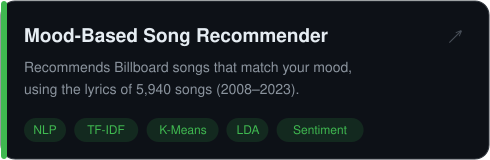
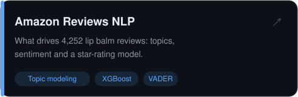
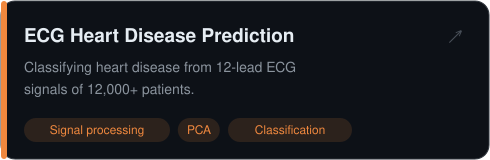
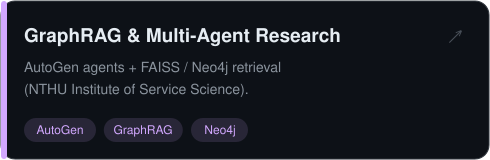
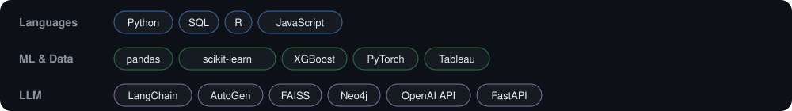

&nbsp;

```python
class PeiChingKan:
    """Data science grad student who turns messy text into decisions."""
    education  = ["M.S. Data Science, Boston University (2026–2027)",
                  "Bachelor's, Economics & Data Science, National Tsing Hua University"]
    focus      = ["NLP", "LLM agents", "RAG / GraphRAG", "machine learning"]
    experience = ["Marketing Data Science Intern @ Taiwan Marketing Research",
                  "Research Assistant, LLM Applications @ NTHU",
                  "Technology & Operations Intern @ DBS Bank"]
    open_to    = "Summer 2027 internships in Data Science / ML / AI"
```

### ✦ Highlights



### ✦ Projects

<p>
  <a href="https://github.com/ganbeik/lyrics-song-recommender"></a>
  <!-- Uncomment each card once its repo is online:
  <a href="https://github.com/ganbeik/amazon-reviews-nlp"></a>
  <a href="https://github.com/ganbeik/ecg-heart-disease-prediction"></a>
  <a href="https://github.com/ganbeik/graphrag-multiagent-research"></a>
  -->
</p>

### ✦ Tech Stack



### ✦ Connect

[](https://www.linkedin.com/in/[your-handle]/)
[](mailto:tristakan@gmail.com)
